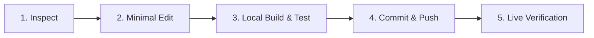

# VSS Engineering & Agent Workflow Guide

> Inspired by Andrej Karpathy's engineering philosophy: **minimal, high-signal, self-contained, and rigorously verified.**  
> This document is the single source of truth for both human contributors and AI agents working on VSS.

---

## 🧭 Repository Architecture at a Glance

```
vss75/
├── .github/workflows/ci.yml       # Automated GitHub Actions build & typecheck CI
├── public/                        # Static assets (logos, worker scripts, authentic samples)
├── scripts/                       # High-value utilities (PDF generation, R2 sync)
├── src/
│   ├── app/                       # Next.js 16 App Router (routes and API endpoints)
│   │   ├── (pages)/               # /, /explore, /notes, /upload, /dashboard, /admin, etc.
│   │   └── api/                   # /api/auth/erp, /api/r2/*, /api/admin/*
│   ├── components/                # Modular UI primitives and compound widgets
│   ├── lib/                       # Business logic, Cloudflare R2 SDK, ERP client
│   └── types/                     # Shared TypeScript interfaces
├── .env.example                   # Environment configuration template
├── next.config.mjs                # Next.js Turbopack configuration
├── tailwind.config.ts             # Tailwind CSS tokens
├── tsconfig.json                  # Strict TypeScript configuration
└── vercel.json                    # Edge routing and security headers
```

---

## 🛡️ Core Architectural Invariants (Golden Rules)

Whenever implementing features or refactoring, you **must adhere to these invariants**:

1. **KL ERP Authentication Only**:
   - Login on `/auth/login` is strictly handled via the KL ERP Portal (`LoginForm.tsx` calling `/api/auth/erp`).
   - Never reintroduce generic "Student ID / Email" login modes or mode switchers unless explicitly requested.
   - Never store or log student ERP passwords anywhere.

2. **Cloudflare R2 as Single Source of Truth**:
   - Uploads and downloads are backed by the Cloudflare R2 bucket `klu-vss-files` through `/api/r2/upload` and `/api/r2/download`.
   - Verified scholar registrations and multi-login records persist in R2 via `klu-vss-files/admin-registry.json`.

3. **Zero Waste & No Fake Clutter**:
   - Do not commit mock uploads, fake files, ad modals, or unneeded binary blobs.
   - Keep `.gitignore` strict (no `node_modules`, `.next`, `*.log`, or temporary files).

4. **Sign-out Integrity**:
   - Signing out from the profile or settings must close the active session and redirect/open `/auth/login`.

5. **Commit Author Identity**:
   - Commits pushed to the deployment repository must use author:  
     `Deepthanush1337 <deepthanush3301@icloud.com>`

---

## 🔄 Standard Development Workflow

Follow this 5-step loop for every task:



### Step 1: Inspect
- Read relevant files in `src/` before modifying them.
- Check active endpoints using `Invoke-RestMethod` or curl.

### Step 2: Minimal Edit
- Implement the exact requirement with surgical precision.
- Avoid introducing unnecessary dependencies or duplicate utility functions.

### Step 3: Local Build & Test
- Run Next.js production build with Turbopack:
  ```bash
  npm run build
  ```
- Ensure `0` TypeScript errors and all static/dynamic routes compile cleanly.

### Step 4: Commit & Push
- Stage only modified source files (avoid staging untracked scratch files).
  ```bash
  git add <file>
  git commit -m "feat/fix: concise description" --author="Deepthanush1337 <deepthanush3301@icloud.com>"
  git push origin main
  ```

### Step 5: Live Verification
- Verify the deployed routes on [https://klu-vss.vercel.app](https://klu-vss.vercel.app) or local dev server at `http://localhost:3000`.

---

## ⚡ Quick Reference Commands

```bash
# Run local dev server with Turbopack
npm run dev

# Full production build & typecheck
npm run build

# Check Cloudflare R2 storage health
Invoke-RestMethod -Uri "http://localhost:3000/api/r2/health" -Method GET
```
